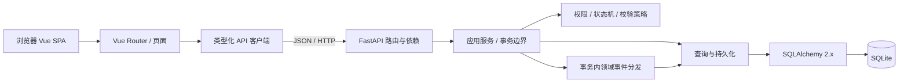

# Learn-Hub 架构设计

状态：设计基线 v1，待确认；所列目录和运行行为是后续工程实施目标。

## 1. 总体结构



前后端独立安装、独立启动。开发环境 Vite 将 `/api` 代理到 FastAPI；生产环境由同源反向代理将 `/api` 转至后端、其他路径转至 SPA 静态文件。当前不引入微服务、消息队列、缓存或 SSR。

## 2. 前端职责与结构

```text
frontend/
  package.json
  package-lock.json
  index.html
  vite.config.ts
  tsconfig*.json
  .env.example
  src/
    main.ts
    App.vue
    assets/main.css
    router/index.ts
    pages/HomePage.vue
    api/client.ts
    api/health.ts
    types/api.ts
```

- `pages/`：渲染页面，展示加载、空、成功、失败状态，处理用户交互。
- `router/`：显式注册页面路径；未来路由守卫只作交互提示，不能代替后端权限。
- `api/`：封装 base URL、超时、JSON 解码、Bearer 令牌与统一错误转换；组件不散落 fetch 调用。
- `types/`：API DTO；后续可从 OpenAPI 生成，禁止复用数据库模型作为前端类型。
- `main.ts`：安装 Vue Router 和 Nuxt UI Vue 插件，导入全局 CSS。
- `App.vue`：使用 `UApp` 包裹 `RouterView`，首页使用 `UCard`、`UBadge`、`UButton` 验证真实组件和交互。
- 第一版令牌仅保存在前端内存，页面刷新需重新登录；持久登录及 Cookie 方案另行设计。

## 3. Nuxt UI 的独立 Vue 集成与验收

依据 [Nuxt UI 官方 Vue 安装指南](https://ui.nuxt.com/docs/getting-started/installation/vue)及其 [官方源文档](https://github.com/nuxt/ui/blob/v4/docs/content/docs/1.getting-started/2.installation/2.vue.md)，采用以下配置路径：

1. 安装 `@nuxt/ui`、`tailwindcss`、Vue、Vue Router；开发依赖包含 Vite、Vue Vite 插件、TypeScript 与 vue-tsc。安装时核实 engine 和 peer dependency，锁定实际兼容版本及 lockfile。
2. `vite.config.ts` 注册 `vue()` 与 `ui()`，后者从 `@nuxt/ui/vite` 导入。
3. `main.ts` 从 `@nuxt/ui/vue-plugin` 导入插件，依次安装 router、ui。
4. 全局 CSS 依次导入 `tailwindcss` 与 `@nuxt/ui`，入口导入该 CSS。
5. 根节点设置 `class="isolate"`；`App.vue` 使用 `UApp`。
6. 将生成的 `auto-imports.d.ts`、`components.d.ts` 纳入 TypeScript include 并忽略提交；按安装版本配置官方所需 `#build/ui` 类型别名。
7. 干净环境先运行 Vite build 生成声明，再执行 vue-tsc，避免声明生成与类型检查竞争。

工程阶段必须实际执行：安装无未解决的 peer 冲突、生产构建、类型检查、浏览器打开首页、检查样式和控制台、点击重试验证组件交互、确认 Network 中健康检查真实到达后端。构建成功本身不足以证明浏览器运行成功。

不得创建 `nuxt.config.ts`、`defineNuxtConfig`、Nuxt server 目录或依赖 Nuxt 页面自动路由。当前尚未安装依赖，因此不预先宣称任何版本组合通过验证。

## 4. 后端职责与结构

```text
backend/
  pyproject.toml
  requirements*.txt       # 工程阶段选择并记录依赖锁定方式
  .env.example
  app/
    main.py              # create_app、lifespan、路由挂载、错误处理
    core/config.py       # 环境配置与校验
    db/base.py           # DeclarativeBase、命名约定
    db/factory.py        # engine / sessionmaker 工厂
    db/init_db.py        # 显式初始化命令
    models/              # 九类 SQLAlchemy 模型
    schemas/health.py    # Pydantic 请求/响应 DTO
    api/dependencies.py  # 数据库 Session；后续当前用户与权限依赖
    api/v1/health.py
    services/health.py
    repositories/health.py
  tests/
    conftest.py
    test_health.py
    test_models.py
```

工程阶段只创建已使用的模块；后续身份、资源、审核业务加入时再创建 `policies/`、`patterns/`、对应 service / repository / schema，不预建无调用关系的类。

| 层 | 负责 | 不应负责 |
| --- | --- | --- |
| API / dependencies | HTTP 参数解析、身份解析、路由级权限、响应状态 | SQL 拼装、直接决定复杂状态流转 |
| Pydantic schemas | 字段类型、长度、枚举、跨字段输入校验，输出过滤 | 数据库访问或信任客户端角色 |
| services | 用例编排、资源级授权、事务、状态转换、事件发布 | HTTP Response 对象、返回 ORM 敏感字段 |
| policies / patterns | 可组合校验、资源类型策略、领域事件处理 | 自行提交事务、绕过服务直接暴露 API |
| repositories | 显式过滤、排序、分页、持久化与并发条件 | 身份认证、自行 commit、替调用者决定权限 |
| models / db | 表结构、关系、约束、连接与 Session 生命周期 | 前端展示、请求解析 |

权限依赖负责角色与账户基础检查；service 必须再执行对象所有权、课程范围、可见性与禁止自审规则。所有业务入口复用这些规则。

## 5. 数据库、事务与生命周期

- 工厂根据配置构造 SQLite engine、配置连接事件和 sessionmaker；文件数据库路径解析为绝对路径，默认位于 `backend/data/learn_hub.db`，不受启动目录变化影响。
- 每个连接执行 `PRAGMA foreign_keys=ON`，包括建表连接；设置有限 busy timeout。SQLite 外键默认不开启，依据 [SQLAlchemy SQLite 官方说明](https://docs.sqlalchemy.org/en/20/dialects/sqlite.html#foreign-key-support)。
- 一个请求一个同步 Session，业务服务开启事务；正常提交、异常回滚、请求结束关闭。使用同步路由访问同步 ORM，避免阻塞异步事件循环。
- 同一审核事务更新资源、插入审核记录、通知与日志。观察者使用传入 Session，不自行新建连接或 commit。
- 资源 `version_id` 通过 SQLAlchemy 乐观锁与请求版本检查防止过期写入。禁止使用绕过 ORM 版本检查的无条件批量更新；冲突转换为 409。
- ORM 关系读取采用显式加载；列表分页先过滤授权范围，再分页，避免查询结果泄漏与 N+1。
- 初始化命令使用 `Base.metadata.create_all`，可重复执行，不填充演示账号、不覆盖数据。它只适合空库初始化，不具备迁移已有表能力；首次模型演进前引入 Alembic。
- 应用启动不隐式建表。健康检查检查 `SELECT 1` 和九张预期表，未初始化返回 503；应用关闭 dispose engine。
- 测试使用独立临时数据库；内存 SQLite 如跨线程访问则使用 StaticPool。不得将测试指向默认开发库。

## 6. 配置、安全与错误处理

后端环境变量计划包含 `DATABASE_URL`、`CORS_ORIGINS`、`APP_ENV`；认证阶段加入 `JWT_SECRET`、`JWT_ISSUER`、`JWT_AUDIENCE`。前端 `VITE_API_BASE_URL` 默认 `/api/v1`，其中不得放密钥。

开发默认后端 `127.0.0.1:8000`，前端 `127.0.0.1:5173`。优先走 Vite 同源代理；允许跨域时只接受配置中的精确 origin，不用通配符代替授权。

FastAPI 统一处理业务异常、请求校验异常、HTTP 异常与未捕获异常。对外返回稳定错误代码与 request_id，对内记录完整异常；请求体、SQL、堆栈和连接路径不返回浏览器。具体格式见 api-contract.md。

## 7. 分阶段实施与验收

| 阶段 | 交付 | 必须验证 |
| --- | --- | --- |
| 当前：任务一 | 五份设计文档 | 术语、字段、权限、状态机和契约一致性；不运行或宣称业务测试 |
| 待确认后：任务二至四 | 两个工程、九类模型、健康检查、首页与启动说明 | Nuxt UI 安装/样式/组件运行、数据库初始化、pytest + HTTPX、类型检查与构建、浏览器真实联调 |
| 后续业务切片一 | 注册、登录、当前用户与后端授权基础 | 用户名冲突、停用账号、伪造角色、令牌过期、敏感字段过滤 |
| 后续业务切片二 | 课程、分类、资源草稿与提交 | 类型策略与责任链真实接入、所有权、状态机、数据库约束 |
| 后续业务切片三 | 审核、通知与日志 | 禁止自审、并发审核、观察者事务回滚 |
| 后续业务切片四 | 检索、收藏与学习进度 | 可见性过滤、重复收藏幂等、个人数据隔离 |

当前文档不包含已执行的工程命令或虚构的运行结果。启动命令、实际依赖版本和测试输出将在工程完成后写入根 README 与验收记录。
