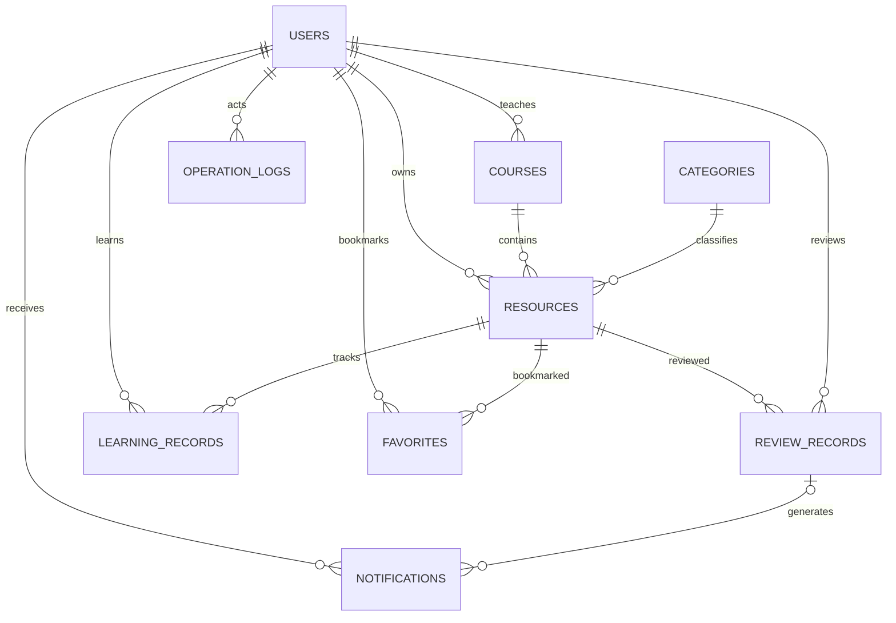

# Learn-Hub 数据库设计

状态：设计基线 v1，待确认；本文件定义后续 SQLAlchemy 2.x 模型，不表示数据库已经创建。

## 1. 通用约定

- SQLite；所有主键 `id` 为 `INTEGER PRIMARY KEY`，由数据库生成，不接受客户端指定。
- 下表字段默认 NOT NULL，标记 `可空` 才允许 NULL。字符串长度需要同时使用 Pydantic 和必要 CHECK 校验，不能假设 SQLite 的 VARCHAR(n) 会强制长度。
- 时间存储为 UTC 的 DATETIME。SQLite 不保留时区，ORM 边界统一转换 UTC，API 序列化补充 `Z`。使用 callable 产生当前时间，禁止模型导入时提前求值。
- `created_at` 创建时生成，`updated_at` 在应用更新时刷新；如有直接 SQL 维护操作，必须显式维护时间。
- 枚举使用字符串及具名 CHECK 约束，避免 SQLite 静默接受非法值。布尔字段使用 CHECK 限定 0/1。
- `RESTRICT` 保留业务和审计关联；当前没有硬删除接口。不能仅依赖 ORM relationship，必须建立数据库外键并对每个连接启用 foreign_keys。
- 本文的 default 为后续 ORM 默认值；原始 SQL 写入必须提供必填值，不依赖未声明的数据库默认。

## 2. 关联关系

用户与资源通过收藏、学习记录分别形成多对多关系。课程负责人外键只能保证用户存在；“负责人是启用教师”由后端事务内验证。日志的通用目标字段不是多态外键，不能保证目标对象存在。

## 3. users：用户

| 字段 | 类型 | 约束/说明 |
| --- | --- | --- |
| id | INTEGER | PK |
| username | VARCHAR(32), COLLATE NOCASE | UNIQUE；3–32 字符；ASCII 字母、数字、下划线；应用规范化为小写 |
| password_hash | VARCHAR(255) | 哈希值；禁止出现在响应 |
| display_name | VARCHAR(64) | 1–64 字符 |
| role | VARCHAR(16) | student / teacher / admin；default student |
| is_active | BOOLEAN | default true |
| created_at | DATETIME | UTC |
| updated_at | DATETIME | UTC |

用户名唯一约束使用 NOCASE，避免并发注册与大小写变体导致重复。ASCII 字符范围在 API 验证，数据库保留长度 CHECK 和唯一约束。

## 4. courses：课程

| 字段 | 类型 | 约束/说明 |
| --- | --- | --- |
| id | INTEGER | PK |
| code | VARCHAR(32), COLLATE NOCASE | UNIQUE；1–32 字符；应用转大写，ASCII 字母、数字、短横线 |
| title | VARCHAR(200) | 1–200 字符 |
| description | TEXT | 最多 5000 字符；default 空字符串 |
| teacher_id | INTEGER | FK → users.id，ON DELETE RESTRICT |
| is_active | BOOLEAN | default true |
| created_at / updated_at | DATETIME | UTC |

索引：`ix_courses_teacher_id`。课程标题可以重复，课程代码唯一。

## 5. categories：分类

| 字段 | 类型 | 约束/说明 |
| --- | --- | --- |
| id | INTEGER | PK |
| name | VARCHAR(64), COLLATE NOCASE | UNIQUE；1–64 字符，应用去首尾空格 |
| description | TEXT | 最多 1000 字符；default 空字符串 |
| is_active | BOOLEAN | default true |
| created_at / updated_at | DATETIME | UTC |

第一版不建父分类。NOCASE 主要处理 ASCII 大小写，不保证 Unicode 的完整大小写折叠或同义词去重。

## 6. resources：学习资源

| 字段 | 类型 | 约束/说明 |
| --- | --- | --- |
| id | INTEGER | PK |
| title | VARCHAR(200) | 1–200 字符 |
| description | TEXT | 最多 5000 字符；default 空字符串 |
| resource_type | VARCHAR(16) | document / video / link |
| url | VARCHAR(2048) | 1–2048 字符；HTTPS、安全 URL 结构由 API 校验 |
| duration_seconds | INTEGER，可空 | video 时必须 > 0；其他类型为空 |
| page_count | INTEGER，可空 | document 时可填且 > 0；其他类型为空 |
| course_id | INTEGER | FK → courses.id，ON DELETE RESTRICT |
| category_id | INTEGER | FK → categories.id，ON DELETE RESTRICT |
| owner_id | INTEGER | FK → users.id，ON DELETE RESTRICT |
| status | VARCHAR(16) | draft / pending / approved / rejected / archived；default draft |
| version_id | INTEGER | default 1；CHECK > 0；配置为 ORM version_id_col |
| created_at / updated_at | DATETIME | UTC |

跨字段 CHECK：video 必须有正 duration 且 page_count 为空；document 的 duration 为空、page_count 为空或正数；link 两者均为空。使用显式 IS NULL / IS NOT NULL，避免 SQL 三值逻辑使非法 NULL 通过。

索引：`ix_resources_course_status_created` (course_id, status, created_at)、`ix_resources_category_status_created` (category_id, status, created_at)、`ix_resources_status_created` (status, created_at)、`ix_resources_owner_created` (owner_id, created_at)。相同 URL 可以属于不同课程或不同用户，不做全局唯一。

状态转换由 service 验证；CHECK 只能限制状态取值。版本号由 SQLAlchemy 更新，配合客户端版本条件避免旧请求覆盖。所有更新必须触发乐观锁。

## 7. review_records：审核记录

| 字段 | 类型 | 约束/说明 |
| --- | --- | --- |
| id | INTEGER | PK |
| resource_id | INTEGER | FK → resources.id，ON DELETE RESTRICT |
| reviewer_id | INTEGER | FK → users.id，ON DELETE RESTRICT |
| resource_version | INTEGER | 审核前 pending 资源的 version_id，CHECK > 0 |
| decision | VARCHAR(16) | approved / rejected |
| comment | TEXT | 最多 2000 字符；通过时可为空字符串，拒绝时去空白后必须非空 |
| created_at | DATETIME | UTC |

唯一约束 `uq_reviews_resource_version` (resource_id, resource_version)，同一待审版本只能形成一个结果；索引 `ix_reviews_reviewer_created` (reviewer_id, created_at)。唯一约束的首列支持按资源查历史。

审核意见的拒绝非空规则用 CHECK 及 Pydantic 兜底；禁止自审、负责课程范围由后端验证。记录创建后不更新。资源在同一事务更新版本，后续重提将使用新版本。

## 8. learning_records：学习记录

| 字段 | 类型 | 约束/说明 |
| --- | --- | --- |
| id | INTEGER | PK |
| user_id | INTEGER | FK → users.id，ON DELETE RESTRICT |
| resource_id | INTEGER | FK → resources.id，ON DELETE RESTRICT |
| progress | INTEGER | CHECK 0 <= progress <= 100；default 0 |
| last_accessed_at | DATETIME | 最近一次用户提交进度的 UTC 时间 |
| created_at / updated_at | DATETIME | UTC |

唯一约束 `uq_learning_user_resource` (user_id, resource_id)；索引 `ix_learning_user_accessed` (user_id, last_accessed_at)、`ix_learning_resource_id` (resource_id)。progress=100 为完成，第一版不另存易失同步的 completed 状态。

## 9. favorites：收藏

| 字段 | 类型 | 约束/说明 |
| --- | --- | --- |
| id | INTEGER | PK |
| user_id | INTEGER | FK → users.id，ON DELETE RESTRICT |
| resource_id | INTEGER | FK → resources.id，ON DELETE RESTRICT |
| created_at | DATETIME | UTC |

唯一约束 `uq_favorites_user_resource` (user_id, resource_id)；索引 `ix_favorites_user_created` (user_id, created_at)、`ix_favorites_resource_id` (resource_id)。取消收藏允许物理删除这条关联记录，重新收藏产生新的 created_at。其他业务实体不硬删除。

## 10. notifications：站内通知

| 字段 | 类型 | 约束/说明 |
| --- | --- | --- |
| id | INTEGER | PK |
| user_id | INTEGER | 接收人；FK → users.id，ON DELETE RESTRICT |
| review_record_id | INTEGER，可空 | FK → review_records.id，ON DELETE RESTRICT |
| kind | VARCHAR(24) | review_result / system |
| title | VARCHAR(200) | 1–200 字符 |
| content | TEXT | 最多 2000 字符；纯文本、脱敏 |
| read_at | DATETIME，可空 | NULL 表示未读，首次标记后保留 |
| created_at | DATETIME | UTC |

CHECK：review_result 必须关联审核记录；system 的 review_record_id 必须为空。唯一约束 `uq_notifications_user_review` (user_id, review_record_id)，防止同次审核重复通知；SQLite 允许多行 NULL，因此不影响多条系统通知。

索引：`ix_notifications_user_read_created` (user_id, read_at, created_at)、`ix_notifications_review_record_id` (review_record_id)。

## 11. operation_logs：操作日志

| 字段 | 类型 | 约束/说明 |
| --- | --- | --- |
| id | INTEGER | PK |
| actor_id | INTEGER | FK → users.id，ON DELETE RESTRICT |
| action | VARCHAR(64) | 如 resource.submit、resource.review、user.update；1–64 字符 |
| target_type | VARCHAR(32) | user / course / category / resource |
| target_id | INTEGER | CHECK > 0；通用目标 ID，由应用验证 |
| request_id | VARCHAR(36) | 服务端生成的 UUID，便于关联诊断 |
| summary | TEXT | 最多 2000 字符；只含脱敏摘要 |
| created_at | DATETIME | UTC |

索引：`ix_logs_actor_created` (actor_id, created_at)、`ix_logs_target_created` (target_type, target_id, created_at)、`ix_logs_created` (created_at)、`ix_logs_request_id` (request_id)。日志只追加，记录成功的管理和资源状态操作；未认证的失败请求进入应用诊断日志，不伪造 actor。

## 12. 数据库与应用规则的边界

| 风险 | 数据库保证 | 后端额外保证 |
| --- | --- | --- |
| 重复用户名/课程代码/分类名称 | 大小写不敏感唯一约束 | 输入规范化、长度与字符规则、409 转换 |
| 重复收藏/学习记录 | user_id + resource_id 唯一 | 幂等 PUT、并发冲突后回读，不忽略其他完整性错误 |
| 无效关联 | FK + RESTRICT | 对象启用状态、负责人角色、可见性 |
| 非法进度/类型/状态 | CHECK | 状态机、权限和元数据策略 |
| 重复审核、过期更新 | 版本唯一 + ORM 乐观锁 | 请求版本匹配、禁止自审、同事务写入 |
| 通知和审核不一致 | FK、通知唯一约束 | 观察者与业务共用事务，异常回滚 |

初始化验收应覆盖九张表、所有外键与唯一约束、跨字段 CHECK、重复初始化不丢数据，以及真实插入触发的约束错误。当前尚未实现或执行这些验证。
